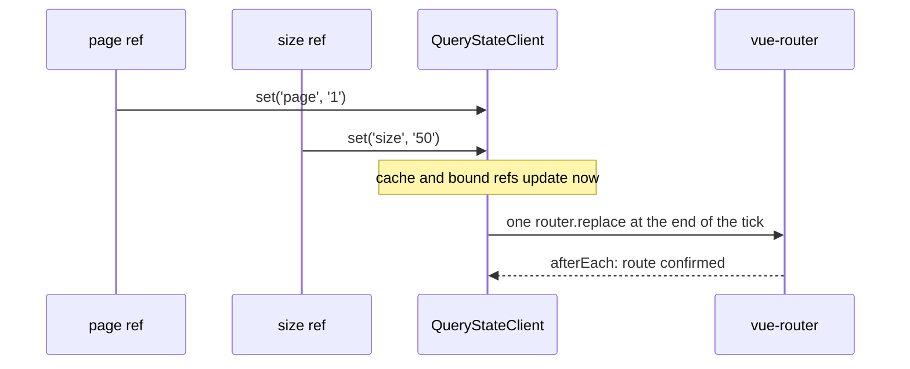

Every write made in the same tick becomes **one** navigation, whichever component or ref it came from. Try both buttons: the first sets three keys in one handler, the second waits 60 ms between writes.

::demo-batching
::

## How it works

One `QueryStateClient` per router sits between the composables and vue-router.



- **Reads** come from the client's cache, filled from the current route.
- **Writes** update the cache and every ref bound to the same key at once, then go to the URL in one `router.replace` or `router.push` when the tick ends (a microtask).
- **Navigations from elsewhere**, such as the back button or a `<RouterLink>`, update the cache and the bound refs after each navigation.
- **Blocked writes**: if a navigation guard refuses the navigation, the refs return to what the URL says.
- **Repeated keys** such as `?tag=a&tag=b` read as their first value. Use `arrayCodec` for lists.

## Why it matters

Without batching, two components writing in the same handler start two navigations. The second can start from the route before the first one landed and drop its key, guards run twice, and with `push` the back button gets two entries for one click.

## Raw access

The client is public. Use it for keys you do not want to type, or for tooling:

```ts twoslash
import { useQueryStateClient } from '@chronicstone/vue-route-query'
// ---cut---
const client = useQueryStateClient()

client.get('page') // '3' or null
client.set('page', '4') // batched like any other write
client.set('page', null) // removes the key
const stop = client.subscribe((key, value) => {
  console.log(key, value)
})
```
